<div align="center">

# NEO-Isle

**Small worlds, made in code: one isle at a time, each a miniature world in a glass container that you can turn, zoom, and watch from dawn to night.**<br>
Fill in a brief, and let your coding agent build the isle.

<a href="https://neohoy.github.io/neo-isle/"></a> <a href="README.zh-CN.md"></a> <a href="https://github.com/neohoy/neo-isle/stargazers"></a> <a href="#thanks-and-notes"></a>

⚠️ **Made for Claude Code.** The isles were built and tuned with Claude;<br>
other agents may not reach the same result.

🆕 **2026-11-11 · [Isle 02: Snowfall Peak](https://neohoy.github.io/neo-isle/#02-snowfall-peak)**: deep winter on a lone peak, a frozen lake, and something glowing under the ice after dark. [See below ↓](#isles)

<sub>Official repo: [github.com/neohoy/neo-isle](https://github.com/neohoy/neo-isle) · NEO造物集 ([@neohoy](https://github.com/neohoy))</sub>

<sub>中文版见 <a href="README.zh-CN.md">README.zh-CN.md</a>。</sub>

</div>

## 🏝️ Isle 02: Snowfall Peak

<table><tr>
<td width="50%" valign="top"><a href="https://neohoy.github.io/neo-isle/#02-snowfall-peak">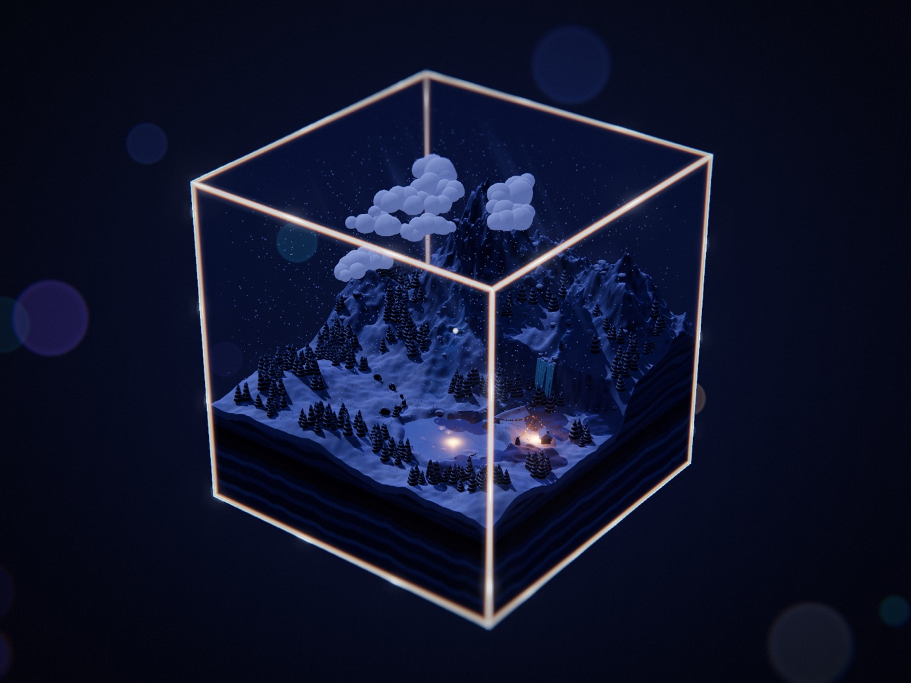</a><br><b>▶ The isle, running</b> · Snowfall Peak · a 24-hour day<br><sub>Snow falls all day on a lone peak. Yaks cross the snowfield in single file, prayer flags shake beside a stone hut, and after dark glowing fish swim under the frozen lake.</sub></td>
<td width="50%" valign="top"><a href="examples/02-雪落寒山/world.js">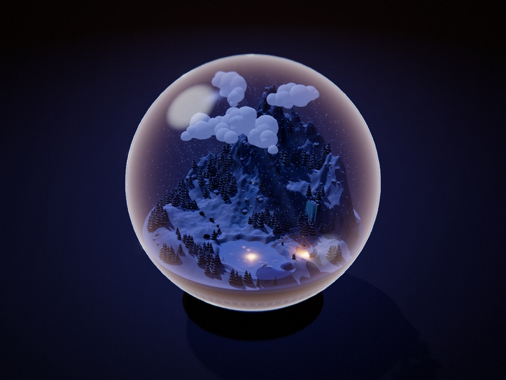</a><br><b>Everything is open</b> · world file · look presets<br><sub>The whole isle is one world file. Change one word and the same isle sits in a glass sphere on a desk: a snow globe.</sub></td>
</tr></table>

What an isle has:

<table>
<tr>
<td width="33%" valign="top">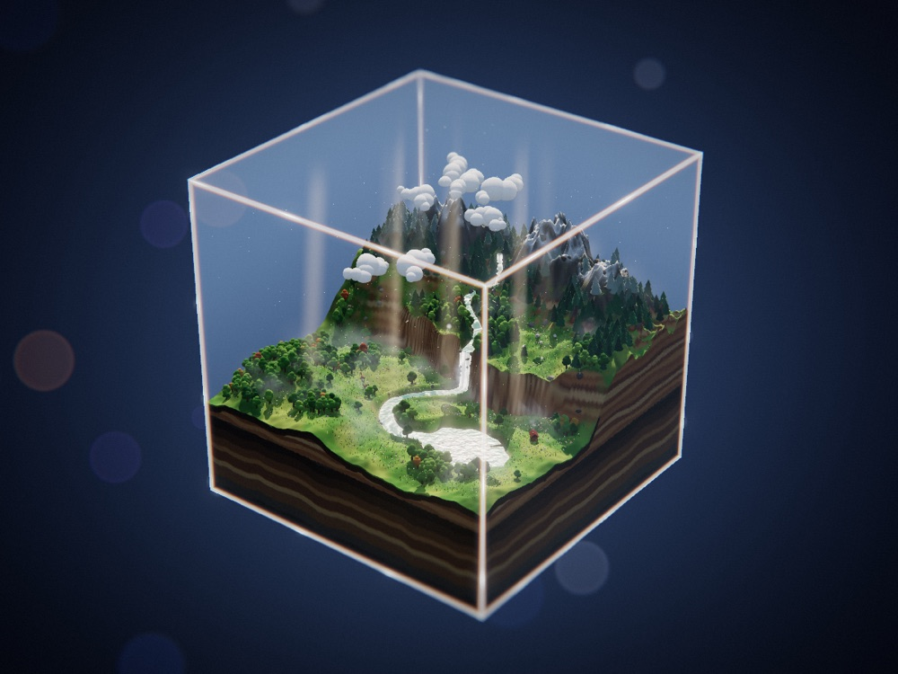<br><b>A glass container</b><br><sub>Cube, dome or sphere. The glass shows only at its edges, where the light splits.</sub></td>
<td width="33%" valign="top">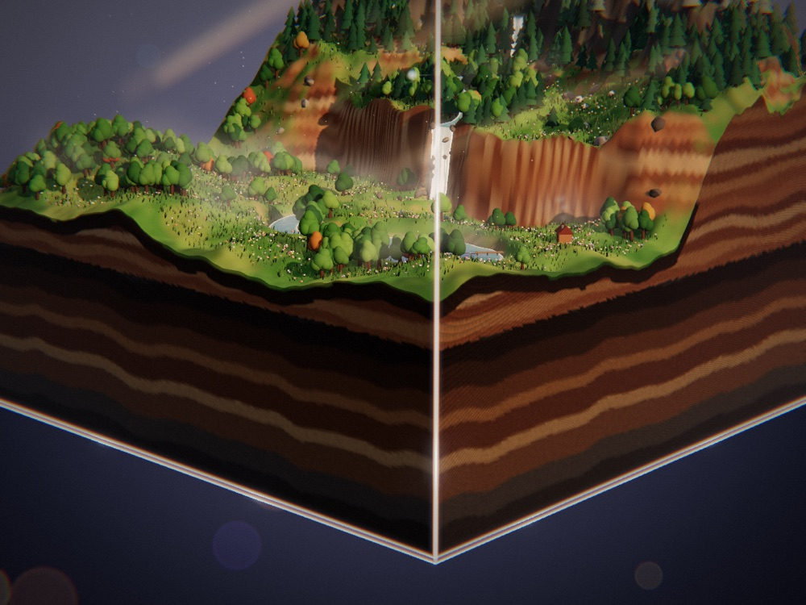<br><b>A cut of the ground</b><br><sub>Every isle is a block cut out of somewhere: the land on top, layered soil on its sides.</sub></td>
<td width="33%" valign="top">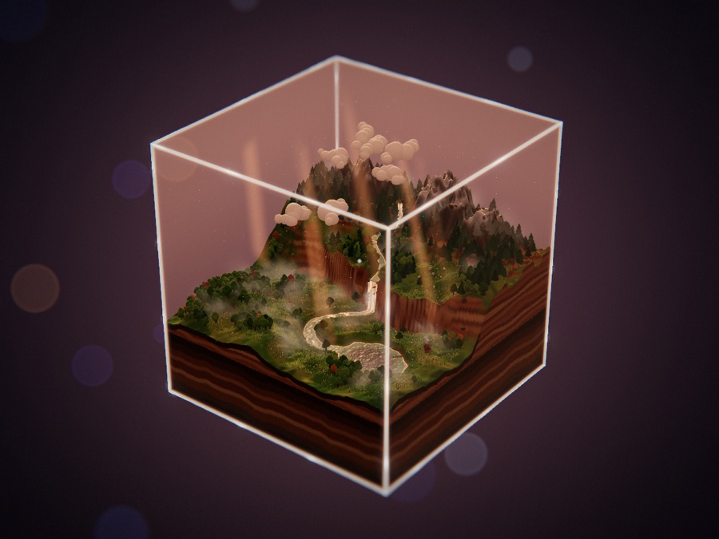<br><b>A whole day</b><br><sub>Dawn, noon, dusk and night in one loop, with mist and light shafts at the low hours.</sub></td>
</tr>
<tr>
<td width="33%" valign="top">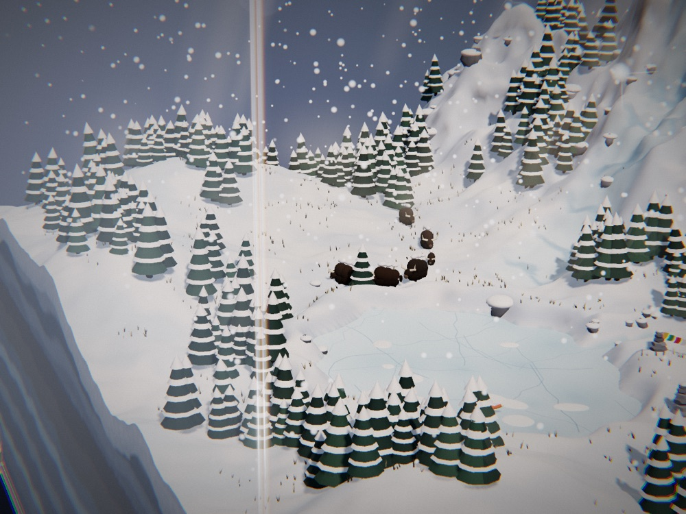<br><b>Things that live there</b><br><sub>Creatures shaped from simple forms, each doing something small and slow.</sub></td>
<td width="33%" valign="top">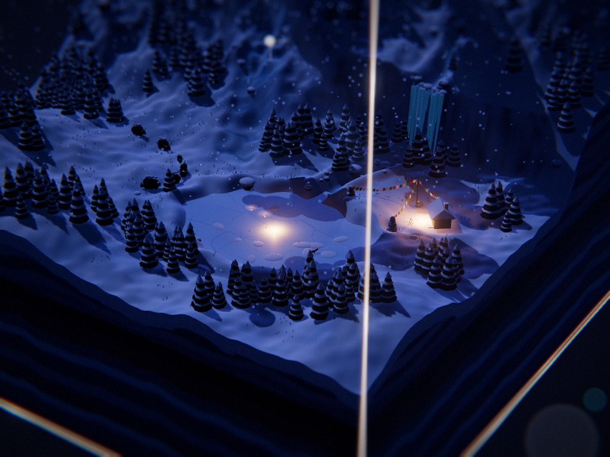<br><b>One wonder</b><br><sub>One impossible, quiet thing per isle, often visible only at a certain hour.</sub></td>
<td width="33%" valign="top">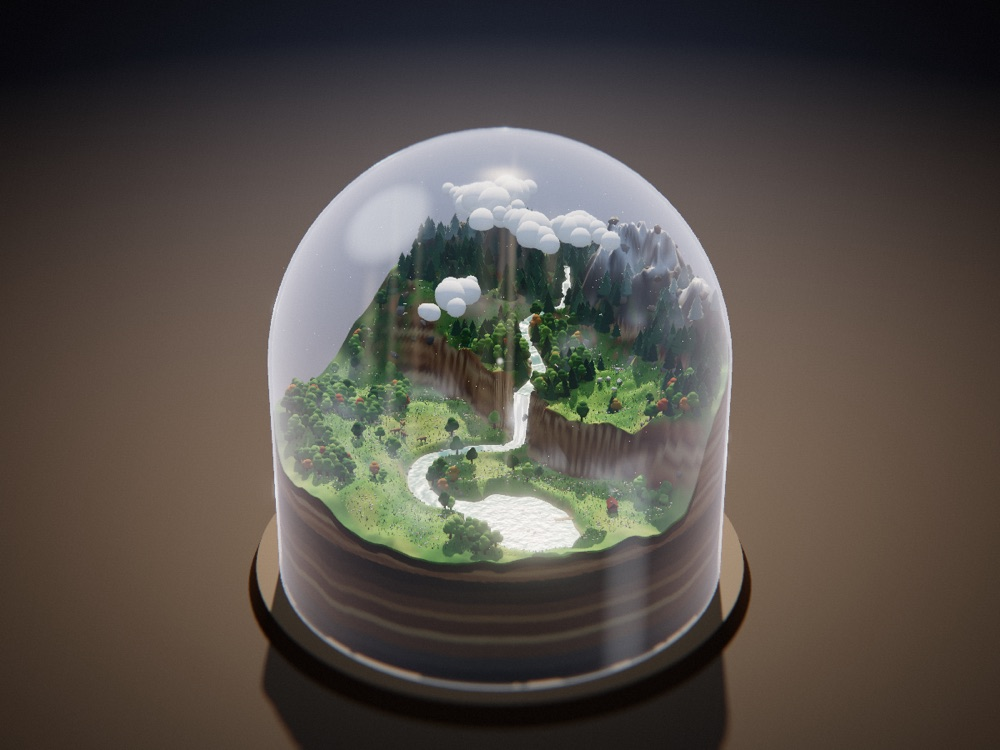<br><b>Looks from presets</b><br><sub>Deep space, a desk, or a plain colour behind it. Each combination was checked in renders.</sub></td>
</tr>
</table>

<div align="center">

Every isle is one web page, written in code. No models, no textures.<br>
[**▶ See it running**](https://neohoy.github.io/neo-isle/) · [**World file**](examples/02-雪落寒山/world.js) · [**How an isle is planned**](references/造境指南.md) · [**Style rules**](references/风格规范.md)

</div>

## 👋 About

I'm **NEO** ([@neohoy](https://github.com/neohoy)). This is the small-worlds skill of NEO造物集, next to [NEO-Cine](https://github.com/neohoy/neo-cine): NEO-Cine makes films, NEO-Isle makes worlds.

> **One isle at a time.** Each isle starts from its own brief and is written from scratch, at the same small size: a world you could hold in two hands.

An isle is not a template with parameters. The skill gives the agent a fixed engine and a set of written guides; the agent reads your brief, writes a plan, then writes the world:

- 🧱 **The engine** guarantees the glass, the day and night, the tilt-shift lens, the mist and light shafts, the soil cross-section and the interface.
- ✍️ **The world file** is new every time: landform, water, plants or buildings, creatures, a trace of people, weather, and one wonder.
- 🔍 **Checked by looking.** The agent renders the isle at four hours of the day, plus close-ups, and fixes what the pictures show.

The subject is open: nature, a miniature city, a medieval town, a cyberpunk block.

## How to use

### Install

```sh
npx skills add neohoy/neo-isle -g -a claude-code
```

or clone it into your skills folder:

```sh
git clone https://github.com/neohoy/neo-isle ~/.claude/skills/neo-isle
```

Other agents can copy the folder into their own skills directory.

### Then just say

> Make an isle: a miniature harbour city at dusk, in a glass dome on a desk.

> Make the next isle. Give me three subjects to choose from first.

Or fill in the brief. Leave out any slot you do not care about:

```text
NEO-Isle · {{name of the isle}}:
{{landform: what is highest, what is lowest}};
{{water: river / lake / sea / spring / ice, or what stands in for it}};
{{one main plant, or one main kind of building}};
{{the lead}} is {{doing what}}, with {{one or two others}};
{{one trace of people: a small building or object}};
{{weather and air: mist, cloud, rain or snow, wind}};
the wonder: {{one impossible, quiet thing}};
palette {{three or four main colours}}, accent {{one}};
at its best at {{daybreak / morning / noon / dusk / night}}.

Container: {{glass cube / glass dome / glass sphere}}
Backdrop: {{deep space / desk / plain colour}}
Glow: {{normal / soft / strong}}
```

The Chinese version of the brief is in [`templates/境帖.md`](templates/境帖.md).

It asks you once, before it starts:

- what in the subject it cannot decide for you;
- anything that must or must not appear;
- which look you want, if you did not say.

Then it works through the guides:

| File | What it gives the agent |
|---|---|
| [`references/造境指南.md`](references/造境指南.md) | How to plan: reading a brief, the nine slots, choosing a look, the wonder, layout |
| [`references/风格规范.md`](references/风格规范.md) | What the engine guarantees, what you may choose, what is made fresh, the acceptance list |
| [`references/制作与避坑.md`](references/制作与避坑.md) | How to build: engine tools, look presets, rendering stills, known pitfalls |

The guides are written in Chinese; talk to the agent in any language.

Every delivery is versioned (`-v001`, `-v002`, ...): the page, the cover, and a copy of the world file. Nothing is overwritten.

### Three layers of change

| Layer | What you can change | How |
|---|---|---|
| Content | Landform, water, plants or buildings, creatures, people's traces, weather, the wonder, palette, best hour | Write anything |
| Look | Container (cube / dome / sphere), backdrop (deep space / desk / plain), glow (soft / normal / strong), your own series title | Choose from presets |
| Style | Anything beyond the presets: another container, another material, another interface | A style of your own, below |

### A style of your own

> I want my own style: glass bottles, low-poly, an English interface.

The agent copies the engine into your series folder (`<series>/_core/`), writes down what your style is, and changes the copy. Every isle in that series then uses it; updates to this skill do not touch it. The steps are in [`references/自成一格.md`](references/自成一格.md).

### Before you start

- Building an isle is real work for an agent: it runs for a while and uses a fair number of tokens.
- You need Python 3 and Google Chrome (used headless to render stills). Nothing else is installed.
- An isle loads three.js from a public CDN when it runs, so it needs a network connection.
- Tested on macOS.

### Update and uninstall

To update, run the install command again (or `git pull` in the cloned folder).

To uninstall, delete the `neo-isle` folder from your skills directory. Your isles live in your own folders and are not touched.

If something gets stuck, [open an issue](https://github.com/neohoy/neo-isle/issues).

## Isles

Click a picture to see the isle in the [gallery](https://neohoy.github.io/neo-isle/). More will be added one at a time.

<!-- isles:start -->

<table>
<tr>
<td width="50%" valign="top"><a href="https://neohoy.github.io/neo-isle/#02-snowfall-peak"></a><br>02 · <b>Snowfall Peak</b><br>雪落寒山<br><sub>Deep winter, snow all day. A lone peak under low cloud, a lake frozen to a mirror, an icefall on the rock step; yaks cross the snowfield in single file and prayer flags shake beside a stone hut. The wonder: after dark, glowing fish swim under the frozen lake.</sub></td>
<td width="50%" valign="top"><a href="https://neohoy.github.io/neo-isle/#01-snow-valley">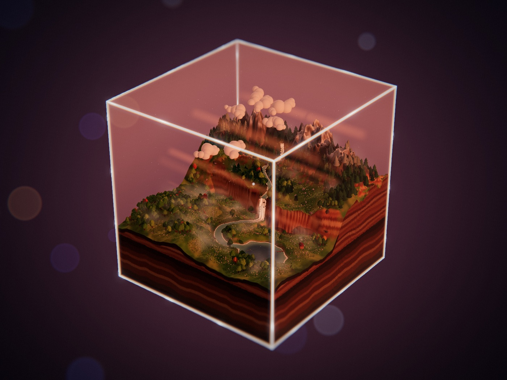</a><br>01 · <b>Snow Valley</b><br>雪山河谷<br><sub>Meltwater leaves the snowline, winds across a plateau, drops over a cliff as a waterfall and reaches a lake. Deer graze by the river; at night one cabin window comes on. This isle has no wonder set.</sub></td>
</tr>
</table>

<!-- isles:end -->

## Looks

The same isle in three of its nine looks. The [gallery](https://neohoy.github.io/neo-isle/#looks) shows all nine and rebuilds the running isle when you pick one.

<table><tr>
<td width="33%" valign="top">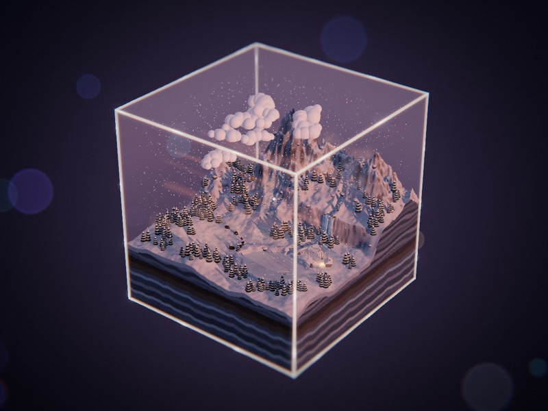<br><b>Cube · deep space</b></td>
<td width="33%" valign="top">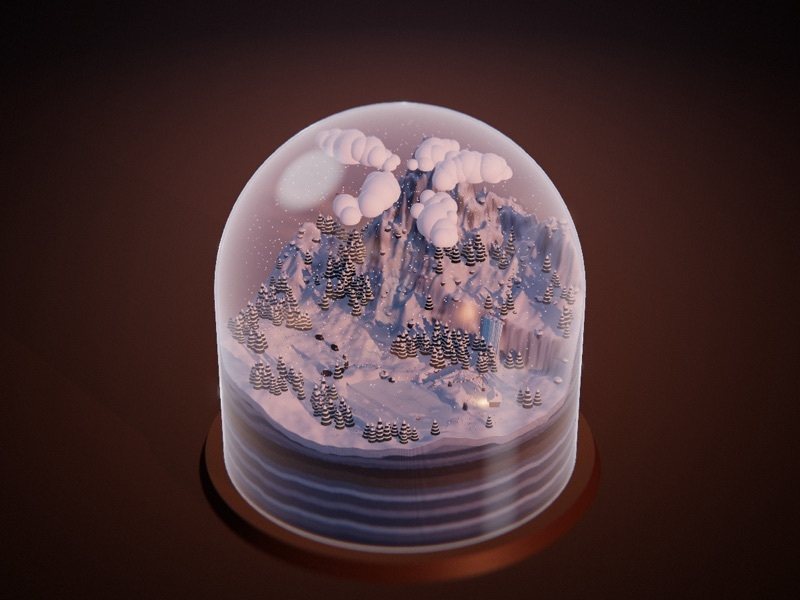<br><b>Dome · desk</b></td>
<td width="33%" valign="top">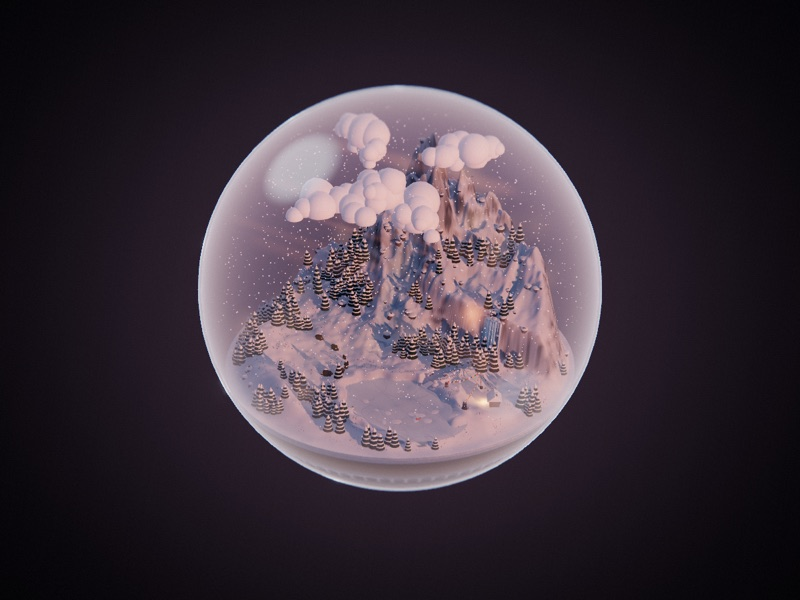<br><b>Sphere · plain</b></td>
</tr></table>

## Star history

<a href="https://www.star-history.com/#neohoy/neo-isle&Date">
 <picture>
   <source media="(prefers-color-scheme: dark)" srcset="https://api.star-history.com/svg?repos=neohoy/neo-isle&type=Date&theme=dark" />
   <source media="(prefers-color-scheme: light)" srcset="https://api.star-history.com/svg?repos=neohoy/neo-isle&type=Date" />
   
 </picture>
</a>

## Thanks and notes

- **[three.js](https://threejs.org/)** renders every isle.
- **[NEO-Cine](https://github.com/neohoy/neo-cine)**: this skill follows the way that library is organised: a thin entry, fixed style kept apart from what is made fresh, a plan before any reference is opened, versioned deliveries.
- **License**: [MIT](LICENSE). The isles you make with this skill are yours.

---

<div align="center">

⭐ **Star the repo**<br>
👀 **Watch → Custom → Releases** to hear about new isles

<sub>NEO造物集 · by neohoy</sub>

</div>
