<div align="center">

# NEO-Isle · 方寸之境

**用代码，造一方小世界：一次只造一座“小岛”，每一座都是装在玻璃容器里的微缩世界，可以拖着转、放大看，从清晨看到深夜。**<br>
填一份境帖，让编程 agent 把它造出来。

<a href="https://neohoy.github.io/neo-isle/"></a> <a href="README.md"></a> <a href="https://github.com/neohoy/neo-isle/stargazers"></a> <a href="#感谢与声明"></a>

⚠️ **为 Claude Code 做的。** 各境都是用 Claude 做出来、调出来的，<br>
换成其他 agent 不保证能做出同样的效果。

🆕 **2026-11-11 · [第二境：雪落寒山](https://neohoy.github.io/neo-isle/#02-snowfall-peak)**：隆冬的孤峰、冻住的湖，入夜后冰面下有东西在发光。[往下看 ↓](#各境)

<sub>官方仓库：[github.com/neohoy/neo-isle](https://github.com/neohoy/neo-isle) · NEO造物集（[@neohoy](https://github.com/neohoy)）</sub>

<sub>本文是 <a href="README.md">README.md</a> 的中文版，以英文版为准。</sub>

</div>

## 🏝️ 第二境：雪落寒山

<table><tr>
<td width="50%" valign="top"><a href="https://neohoy.github.io/neo-isle/#02-snowfall-peak">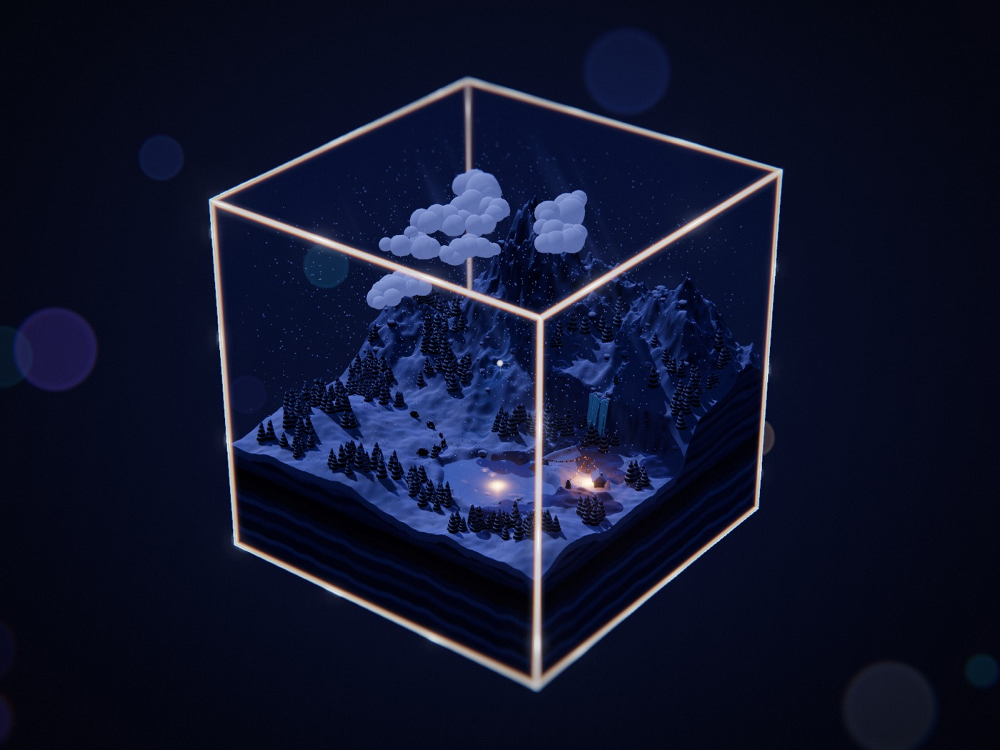</a><br><b>▶ 正在运行的一境</b> · 《雪落寒山》 · 一天二十四小时<br><sub>雪在孤峰上下了一整天。牦牛排成一行走过雪原，石屋旁的经幡在风里抖；入夜后，冻住的湖面下有发光的鱼在游。</sub></td>
<td width="50%" valign="top"><a href="examples/02-雪落寒山/world.js">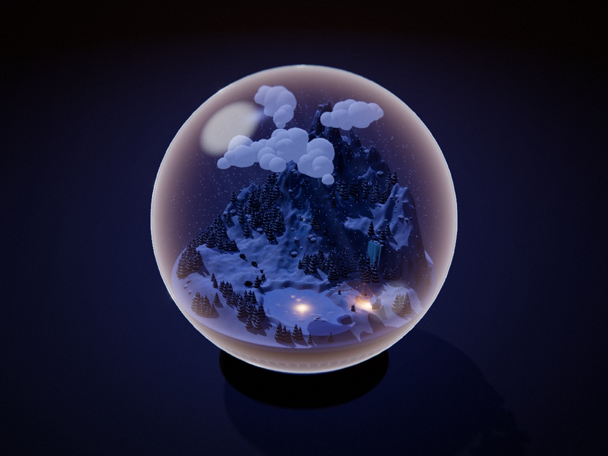</a><br><b>全部公开</b> · 世界文件 · 外观预设<br><sub>整个一境就是一个世界文件。改一个词，同一境就装进玻璃球、落在桌面上，成了一只雪景球。</sub></td>
</tr></table>

一境里有什么：

<table>
<tr>
<td width="33%" valign="top">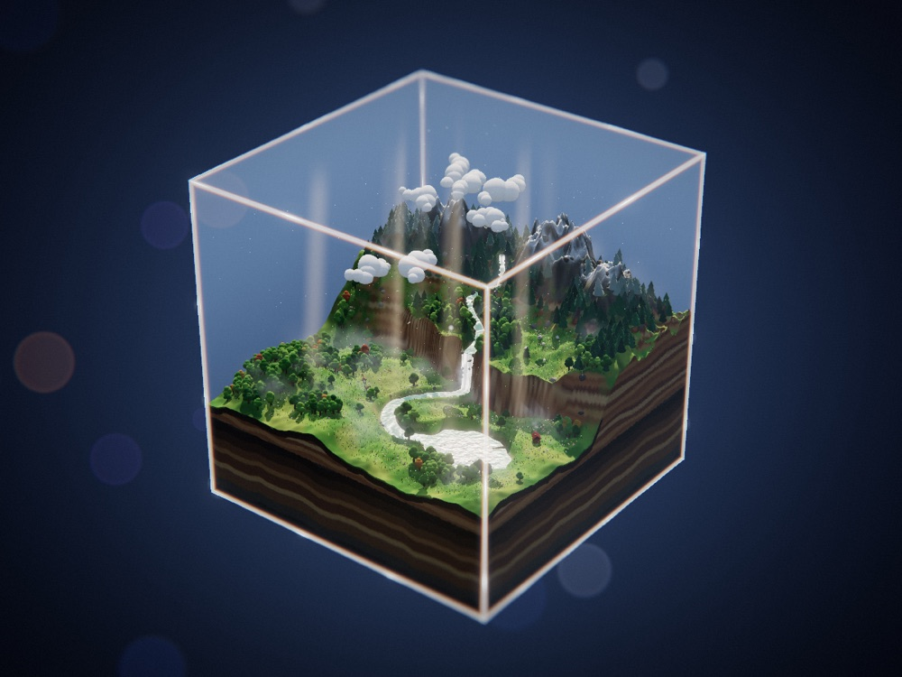<br><b>一只玻璃容器</b><br><sub>立方体、钟罩或球。玻璃只在边缘看得见，光在那里分出颜色。</sub></td>
<td width="33%" valign="top">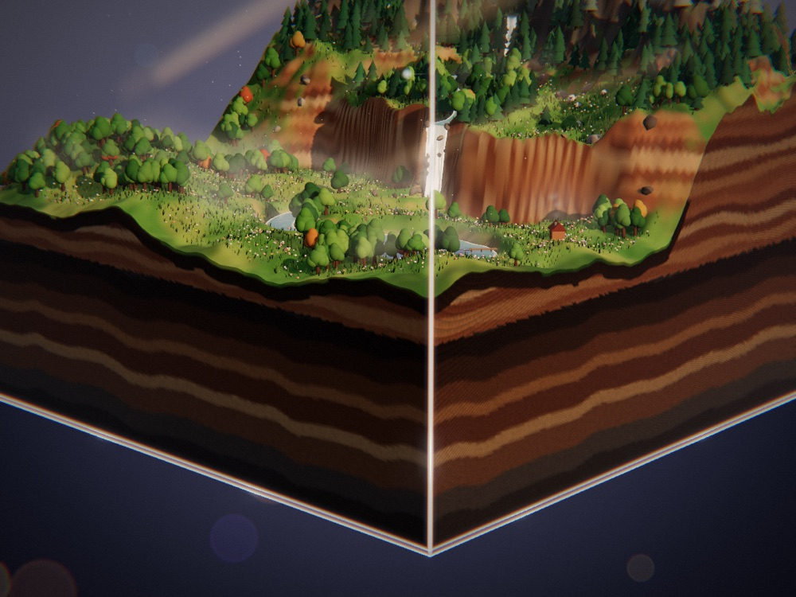<br><b>一块切下来的地</b><br><sub>每一境都像从某个地方切下来的一块：上面是地貌，侧面是分层的土。</sub></td>
<td width="33%" valign="top">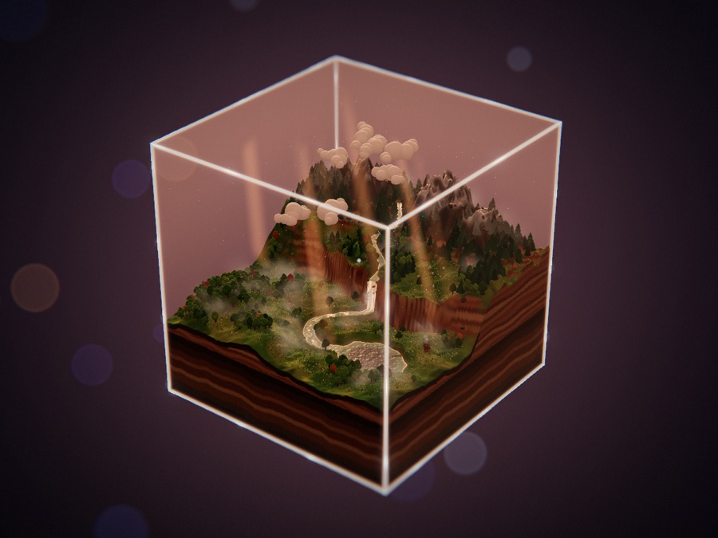<br><b>完整的一天</b><br><sub>清晨、正午、黄昏、夜晚循环流转，晨昏时有薄雾和光柱。</sub></td>
</tr>
<tr>
<td width="33%" valign="top">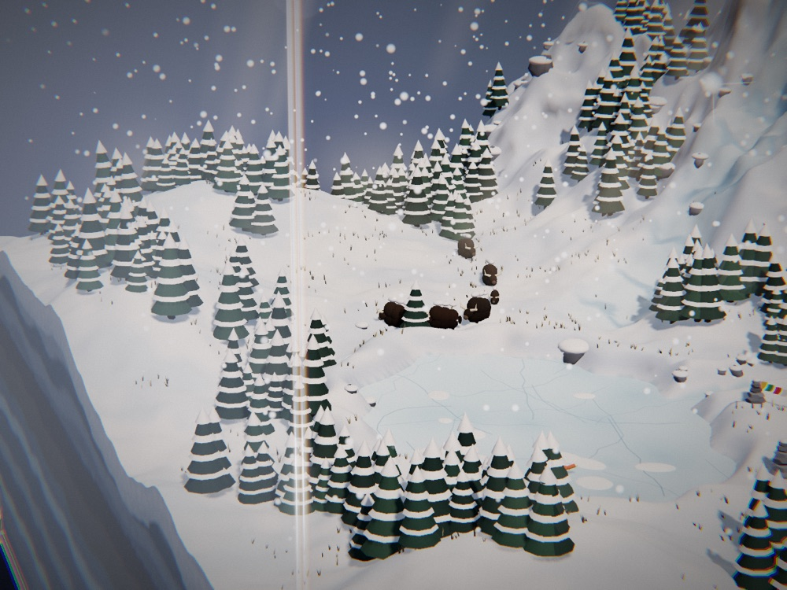<br><b>住在里面的生灵</b><br><sub>用基本形体捏出来的活物，各自做着又小又慢的事。</sub></td>
<td width="33%" valign="top">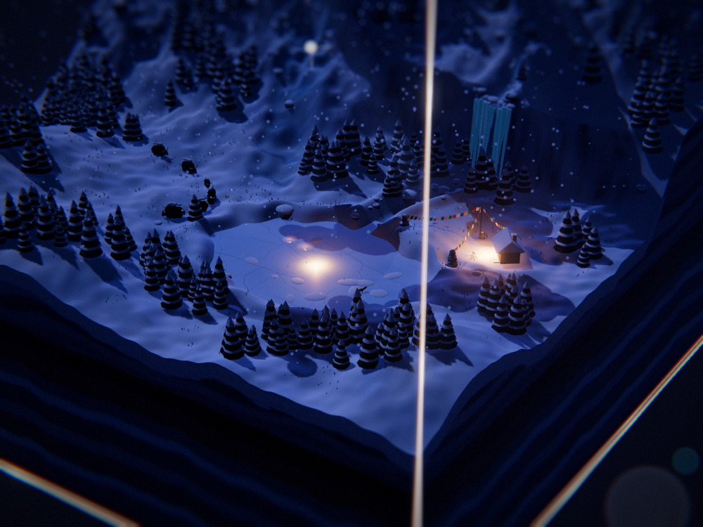<br><b>一件奇事</b><br><sub>每一境只有一件不可能、却很安静的事，常常要等到某个时辰才看得见。</sub></td>
<td width="33%" valign="top">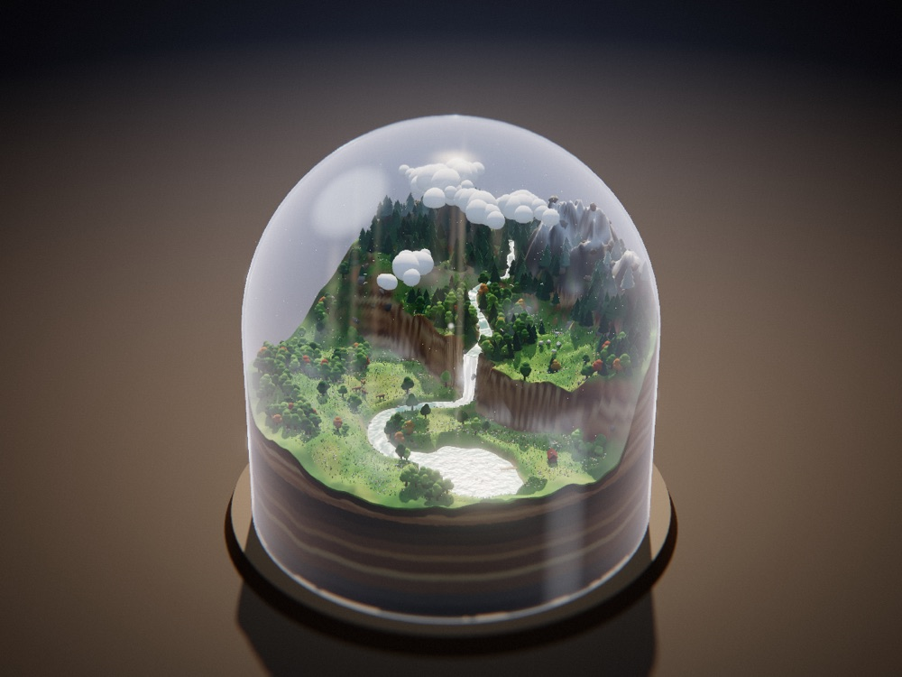<br><b>外观从预设里选</b><br><sub>背后可以是深空、桌面或一个纯色。每一种组合都出图验证过。</sub></td>
</tr>
</table>

<div align="center">

每一境都是一个用代码写出来的网页。不用模型，不用贴图。<br>
[**▶ 看它运行**](https://neohoy.github.io/neo-isle/) · [**世界文件**](examples/02-雪落寒山/world.js) · [**一境是怎么立意的**](references/造境指南.md) · [**风格规范**](references/风格规范.md)

</div>

## 👋 关于

我是 **NEO**（[@neohoy](https://github.com/neohoy)），这里是 NEO造物集里造小世界的技能，和 [NEO-Cine](https://github.com/neohoy/neo-cine) 并排：NEO-Cine 做影像，NEO-Isle 造世界。

> **一次只造一境。** 每一境都从自己的境帖出发，从头写起，大小都一样：双手捧得住的一方世界。

一境不是带参数的模板。技能给 agent 的是一个固定的引擎和几份文字指南；agent 读懂你的境帖，先写方案，再把世界写出来：

- 🧱 **引擎**负责玻璃、昼夜、移轴镜头、薄雾和光柱、土层剖面、界面。
- ✍️ **世界文件**每次新写：地貌、水、植被或建筑、生灵、人迹、天气，还有一件奇事。
- 🔍 **看图把关。** agent 会在四个时辰各出一张图，再加几张近景，照着图里看到的问题改。

题材不限：自然、微缩城市、中世纪小镇、赛博街区都可以。

## 怎么用

### 安装

```sh
npx skills add neohoy/neo-isle -g -a claude-code
```

或者克隆到你的技能目录：

```sh
git clone https://github.com/neohoy/neo-isle ~/.claude/skills/neo-isle
```

其他 agent 可以把这个文件夹复制到它们的技能目录。

### 然后直接说

> 做一境：黄昏的微缩港口城市，装在玻璃钟罩里，放在桌面上。

> 做下一境，先给我三个题材挑。

也可以填境帖。不在意的槽位直接删掉：

```text
方寸之境 · {{境名}}：
{{地貌：最高处是什么，最低处是什么}}；
{{水：河 / 湖 / 海 / 泉 / 冰，或者用什么代替水}}；
{{主体植被或主体建筑：一种}}；
{{主角}}正在{{做什么}}，另有{{配角一两种}}；
{{一处人迹：小建筑或器物}}；
{{天气与空气：雾、云、雨雪、风}}；
一奇：{{一件不可能、却很安静的事}}；
色调{{三四个主色}}，点缀{{一个点缀色}}；
最美在{{拂晓 / 晨光 / 正午 / 黄昏 / 夜晚}}。

容器：{{玻璃立方体 / 玻璃钟罩 / 玻璃球}}
背景：{{深空 / 桌面 / 纯色}}
光效：{{适中 / 柔和 / 强烈}}
```

带例子的完整版在 [`templates/境帖.md`](templates/境帖.md)。

它开工前只问你一次：

- 题材里它定不了的事；
- 必须出现或者不要出现的东西；
- 你没说外观时，要用哪一种。

然后照着几份指南做：

| 文件 | 给 agent 的东西 |
|---|---|
| [`references/造境指南.md`](references/造境指南.md) | 怎么立意：读境帖、九个槽位、选外观、一奇、布局 |
| [`references/风格规范.md`](references/风格规范.md) | 哪些由引擎保证、哪些可以选、哪些每境重做、验收清单 |
| [`references/制作与避坑.md`](references/制作与避坑.md) | 怎么做：引擎工具、外观预设、出图、踩过的坑 |

每次交付都带版本号（`-v001`、`-v002`……）：网页、封面，还有一份世界文件的留档。不覆盖旧版。

### 三层定制

| 层 | 能改什么 | 怎么改 |
|---|---|---|
| 内容 | 地貌、水、植被或建筑、生灵、人迹、天气、一奇、色调、最美时辰 | 随便写 |
| 外观 | 容器（立方体 / 钟罩 / 球）、背景（深空 / 桌面 / 纯色）、光效（柔和 / 适中 / 强烈）、你自己的系列名 | 从预设里选 |
| 风格 | 预设之外的一切：别的容器、别的质感、别的界面 | 自成一格，见下 |

### 自成一格

> 我要一套自己的风格：玻璃瓶、低多边形、英文界面。

agent 会把引擎复制到你的系列目录里（`<系列目录>/_core/`），写下你这套风格是什么，然后改这份副本。这个系列里的每一境都用它；技能更新不会动它。步骤写在 [`references/自成一格.md`](references/自成一格.md) 里。

### 开始之前

- 造一境对 agent 来说是实打实的活：要跑不短的时间，也要用不少 token。
- 需要 Python 3 和 Google Chrome（无界面运行，用来出图）。不用再装别的。
- 每一境运行时从公共网络加载 three.js，所以打开时要联网。
- 在 macOS 上测过。

### 更新和卸载

更新：把安装命令再跑一遍（克隆安装的就在那个文件夹里 `git pull`）。

卸载就是把技能目录里的 `neo-isle` 文件夹删掉。你造的各境在你自己的文件夹里，不会被动到。

哪一步卡住了，[提一个 issue](https://github.com/neohoy/neo-isle/issues)。

## 各境

点图到[示例页](https://neohoy.github.io/neo-isle/)里看它运行。后面的境会一座一座加进来。

<!-- isles:start -->

<table>
<tr>
<td width="50%" valign="top"><a href="https://neohoy.github.io/neo-isle/#02-snowfall-peak"></a><br>02 · <b>雪落寒山</b><br>Snowfall Peak<br><sub>隆冬大雪。一座孤峰压在云底下，湖冻成一面镜子，岩阶上挂着冰瀑；牦牛排成一行走过雪原，石屋旁的经幡在风里抖。 一奇：入夜后，冻住的湖面下有发光的鱼在游。</sub></td>
<td width="50%" valign="top"><a href="https://neohoy.github.io/neo-isle/#01-snow-valley">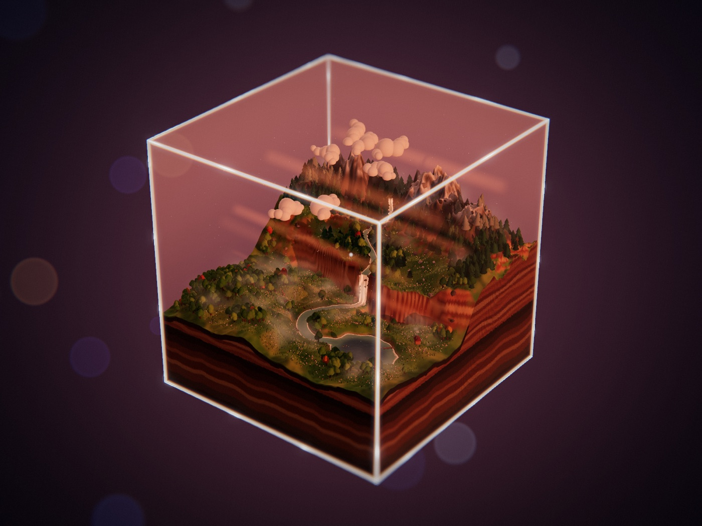</a><br>01 · <b>雪山河谷</b><br>Snow Valley<br><sub>雪线化水，在高台上绕两个弯，越过断崖成瀑布，再绕过草甸流进湖里。鹿在河边低头吃草，入夜木屋亮起一扇窗。 这一境没有设奇事。</sub></td>
</tr>
</table>

<!-- isles:end -->

## 外观

同一境的九种外观里的三种。[示例页](https://neohoy.github.io/neo-isle/#looks)里有全部九种，点哪一种，正在运行的那一境就按它重新搭一遍。

<table><tr>
<td width="33%" valign="top">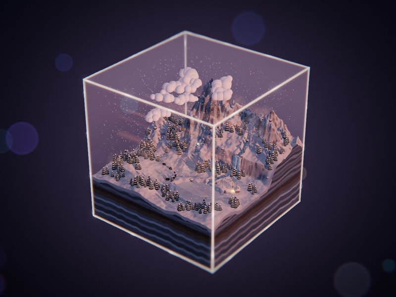<br><b>立方体 · 深空</b></td>
<td width="33%" valign="top">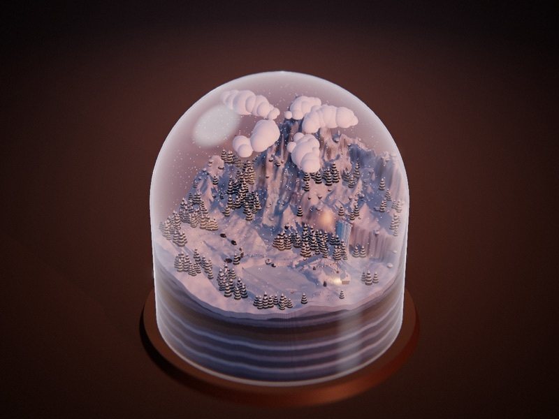<br><b>钟罩 · 桌面</b></td>
<td width="33%" valign="top">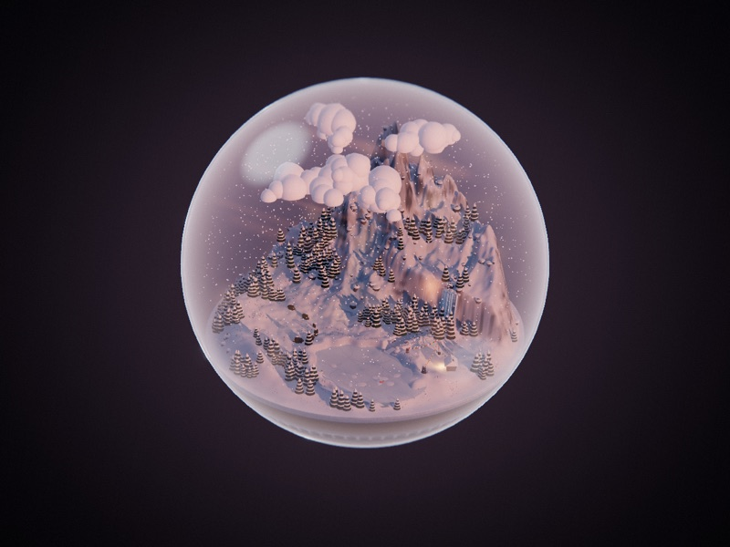<br><b>球 · 纯色</b></td>
</tr></table>

## Star 增长

<a href="https://www.star-history.com/#neohoy/neo-isle&Date">
 <picture>
   <source media="(prefers-color-scheme: dark)" srcset="https://api.star-history.com/svg?repos=neohoy/neo-isle&type=Date&theme=dark" />
   <source media="(prefers-color-scheme: light)" srcset="https://api.star-history.com/svg?repos=neohoy/neo-isle&type=Date" />
   
 </picture>
</a>

## 感谢与声明

- **[three.js](https://threejs.org/)** 负责渲染每一境。
- **[NEO-Cine](https://github.com/neohoy/neo-cine)**：这个技能沿用了那个库的组织方式：入口很薄，固定的风格和每次重做的内容分开，先写方案再看示范，交付升版不覆盖。
- **许可**：[MIT](LICENSE)。你用这个技能造出来的各境归你自己。

---

<div align="center">

⭐ **点个星**<br>
👀 **Watch → Custom → Releases**，有新的一境会通知你

<sub>NEO造物集 · by neohoy</sub>

</div>
